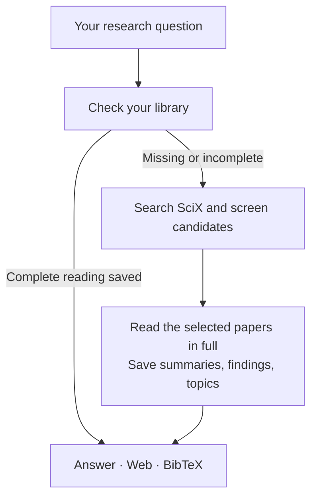
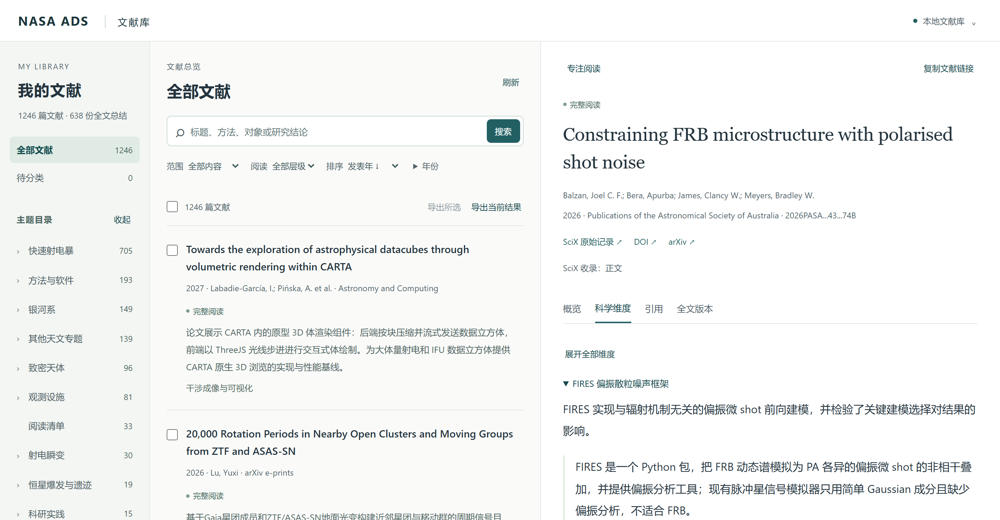

<h1 align="center">NASA ADS Skill</h1>

<div align="center">

**Astronomy research with a reusable personal literature library**

Literature reviews · Manuscript evidence · Local Web · BibTeX

[](https://scixplorer.org/)
[](plugins/nasa-ads/.codex-plugin/plugin.json)
[](https://www.python.org/)
[](#open-the-web-library)
[](LICENSE)
[](https://github.com/SukiYume/nasa-ads-skill)

[Overview](#overview) ·
[Install](#install-with-one-agent-prompt) ·
[Use it](#use-it) ·
[Your library](#what-the-library-keeps) ·
[Web](#open-the-web-library) ·
[Help](#troubleshooting) ·
[简体中文](README.zh-CN.md)

</div>

---

## Overview

**NASA ADS Skill** brings [SciX](https://scixplorer.org/), the NASA Science Explorer that succeeds NASA ADS, into Claude Code, Codex, Gemini CLI, and other Markdown-skill hosts. You ask an astronomy question in plain language; the agent searches SciX, reads the papers, and answers with traceable evidence for **reviews, introductions, methods, and discussions**.

Every task also builds a library you keep:

- **Whole papers, not abstracts.** Each paper the agent opens is read in full, once, and the whole article is summarized into your library, whatever the question was: a one-line summary, a paragraph summary, a summary of every section, and each citable result with its key numbers, its section, table, figure, or equation, and a short verbatim quote. The next question about that paper starts from the saved summary.
- **Cite the exact result.** A manuscript often cites a paper for one number or one inference. You can later retrieve that specific result with its location, citation key, and original source, and reopen only the paragraph of the saved article that states it.
- **Browse and export.** A local Web page lets you browse the library by topic and writing role, and export BibTeX.

### How It Works



Saving happens quietly as part of the task; you receive the science, and the library grows in the background.

## Install with One Agent Prompt

Paste this prompt into an agent that has terminal and internet access. It follows the right instructions for your host and checks the installation.

<details>
<summary><strong>Copy the installation prompt</strong> · The agent completes setup and verification</summary>

```text
Install the current NASA ADS Skill from https://github.com/SukiYume/nasa-ads-skill on this computer: read its README and follow the Install section for the current agent host, install missing prerequisites and the complete skill, replace only an existing nasa-ads installation when needed, check ADS_API_TOKEN without displaying its value and guide me through token setup for online SciX access when it is absent, verify SKILL.md, agents/openai.yaml, scripts/ads_api.py, scripts/fulltext.py, scripts/literature_db.py, scripts/library_catalog.py, scripts/library_migrate.py, scripts/library_web.py, scripts/adslib.py, assets/index.html, assets/style.css, assets/app.js, references/research-writing.md, references/ads-cli.md, references/fulltext.md, references/literature-memory.md, references/library-maintenance.md, references/digest-schema.md, references/libraries.md, and references/http-fallback.md, read the installed SKILL.md, run all four CLI version checks, run install from the installed scripts/adslib.py to register the adslib command and verify adslib --version in a fresh terminal, run the API, full-text, and library checks from the README's Verify the Installation section when credentials are available, verify that the Web page loads, and report the installed path, version, and results.
```

</details>

## Install

### Requirements

- **An agent host**: [Claude Code](https://code.claude.com/docs/en/setup), [Codex](https://developers.openai.com/codex/cli/), [Gemini CLI](https://geminicli.com/docs/get-started/installation/), or another assistant that loads Markdown skills.
- **[Python 3.10 or newer](https://www.python.org/downloads/)** for full-text reading, the personal library, and Web. The bundled scripts use only the standard library. Without Python, the agent can still make basic SciX requests through `curl` or PowerShell, without full-text reading or a saved library.
- **[Git](https://git-scm.com/downloads/)** for the standalone and Gemini installations.
- **A SciX token** for online searches; see [Configure the SciX Token](#configure-the-scix-token). Browsing your library and exporting cached citations work offline.
- **Optional PDF tools**: `pdftotext` and `pdfinfo` improve PDF text extraction, and `pdftoppm` renders scanned pages. Without them, a capable host reads PDFs or page images visually.
- **HTTPS access** to `api.scixplorer.org`, `arxiv.org`, and publisher or repository sites.

Pick the installation for your host:

| Your host | Installation | How to call the skill |
| --- | --- | --- |
| **Claude Code** | [Plugin](#claude-code-plugin) or [standalone skill](#standalone-skill) | Plain language or `/nasa-ads:ads-search` |
| **Codex CLI / desktop app** | [Plugin](#codex-plugin) or [standalone skill](#standalone-skill) | Plain language or `$nasa-ads` |
| **Codex IDE extension** | [Standalone skill](#standalone-skill) | Plain language or `$nasa-ads` |
| **Gemini CLI** | [`GEMINI.md` import](#gemini-cli) | Plain language |
| **Other assistants** | [Markdown skill folder](#other-hosts) | The host's skill-loading method |

After any installation, [register the adslib command](#register-the-adslib-command) once and [configure the SciX token](#configure-the-scix-token).

### Claude Code Plugin

In Claude Code 2.1.275 or later, run this inside a session:

```text
/plugin install nasa-ads --marketplace SukiYume/nasa-ads-skill
```

On any version, run these in a terminal:

```bash
claude plugin marketplace add SukiYume/nasa-ads-skill
claude plugin install nasa-ads@nasa-ads-community
claude plugin list
```

The list should include `nasa-ads@nasa-ads-community`. Start `claude`, or run `/reload-plugins` in an open session.

### Codex Plugin

Codex plugins work in Codex CLI and the desktop app:

```bash
codex plugin marketplace add SukiYume/nasa-ads-skill
codex plugin add nasa-ads@nasa-ads-community
codex plugin list
```

Start a new Codex session so the skill appears in `/skills`.

### Standalone Skill

A standalone skill is a copy of the skill folder in the host's skill directory: `~/.agents/skills/nasa-ads` for Codex CLI and the IDE extension, or `~/.claude/skills/nasa-ads` for Claude Code. Keep a source clone so you can update it later.

macOS, Linux, or WSL:

```bash
git clone --depth 1 https://github.com/SukiYume/nasa-ads-skill.git "$HOME/.local/share/nasa-ads-skill"
skill_dir="$HOME/.agents/skills/nasa-ads"    # Claude Code: "$HOME/.claude/skills/nasa-ads"
mkdir -p "$skill_dir"
cp -R "$HOME/.local/share/nasa-ads-skill/plugins/nasa-ads/skills/nasa-ads/." "$skill_dir/"
```

Windows PowerShell:

```powershell
$nasaAdsSource = Join-Path $HOME 'nasa-ads-skill-source'
$skillDir = Join-Path $HOME '.agents\skills\nasa-ads'    # Claude Code: '.claude\skills\nasa-ads'
git clone --depth 1 https://github.com/SukiYume/nasa-ads-skill.git $nasaAdsSource
New-Item -ItemType Directory -Force $skillDir | Out-Null
Copy-Item -Recurse -Force (Join-Path $nasaAdsSource 'plugins\nasa-ads\skills\nasa-ads\*') $skillDir
```

Start a new session. In Codex, `/skills` lists it and `$nasa-ads` calls it. For one repository only, copy the same folder to `<repository>/.agents/skills/nasa-ads`.

### Gemini CLI

Gemini CLI loads the skill through `~/.gemini/GEMINI.md`.

macOS, Linux, or WSL:

```bash
git clone --depth 1 https://github.com/SukiYume/nasa-ads-skill.git "$HOME/.gemini/nasa-ads-skill"
printf '\n@./nasa-ads-skill/plugins/nasa-ads/skills/nasa-ads/SKILL.md\n' >> "$HOME/.gemini/GEMINI.md"
```

Windows PowerShell:

```powershell
git clone --depth 1 https://github.com/SukiYume/nasa-ads-skill.git "$HOME\.gemini\nasa-ads-skill"
Add-Content -Path "$HOME\.gemini\GEMINI.md" -Value "`n@./nasa-ads-skill/plugins/nasa-ads/skills/nasa-ads/SKILL.md"
```

Start `gemini`, then run `/memory reload` and `/memory show`; the loaded memory should contain the `SciX Literature Workflow` heading. The repository's own [`GEMINI.md`](GEMINI.md) shows the same import for a project-level setup.

### Other Hosts

Clone the repository, copy the complete `plugins/nasa-ads/skills/nasa-ads/` folder into the host's skill or prompt directory, and configure the host to load `SKILL.md`. The host needs Python 3 to run the bundled scripts. Discovery directories and invocation syntax depend on the host's own documentation.

### Register the adslib Command

`adslib` opens your Web library from any terminal. Register it once per computer by running `install` from the installed skill folder, or ask the agent:

> Locate scripts/adslib.py in the installed nasa-ads skill, run install to register adslib while preserving my PATH settings, and verify adslib --version in a new terminal.

For a Codex standalone skill:

```bash
python3 "$HOME/.agents/skills/nasa-ads/scripts/adslib.py" install     # macOS, Linux, or WSL
```

```powershell
python "$HOME\.agents\skills\nasa-ads\scripts\adslib.py" install       # Windows PowerShell
```

A Claude Code standalone skill uses `~/.claude/skills/nasa-ads/scripts/adslib.py`, Gemini uses the script inside `~/.gemini/nasa-ads-skill`, and a plugin uses the folder that holds its loaded `SKILL.md`, which the agent can tell you.

The installer creates `~/.local/bin/adslib` (plus `adslib.cmd` on Windows) and adds that directory to your PATH when needed, keeping your existing settings and any unrelated `adslib` command. Use `install --bin-dir <directory> --no-path` to choose a directory whose PATH you manage yourself. Open a new terminal and check `adslib --version`. Run `install` again after moving the skill, changing Python, or updating a plugin, since plugin updates use a new folder.

## Configure the SciX Token

Online SciX requests need a personal token stored in `ADS_API_TOKEN`. NASA ADS accounts and tokens work on SciX unchanged.

1. Open [SciX token settings](https://scixplorer.org/user/settings/token) and sign in.
2. Generate a token under **API Token** and copy it.
3. Save it as an environment variable, then open a new terminal and restart your agent.

macOS, Linux, or WSL: add this line to your shell startup file, such as `~/.zshrc` or `~/.bashrc`:

```bash
export ADS_API_TOKEN='paste-your-token-here'
```

Windows PowerShell:

```powershell
[Environment]::SetEnvironmentVariable('ADS_API_TOKEN', 'paste-your-token-here', 'User')
```

Check that the token is set without printing it:

```bash
if [ -n "${ADS_API_TOKEN:-}" ]; then echo "SciX token is set"; else echo "SciX token is missing"; fi
```

```powershell
if ($env:ADS_API_TOKEN) { 'SciX token is set' } else { 'SciX token is missing' }
```

Keep the token out of repositories, screenshots, logs, and support messages; regenerate it in SciX settings if it is exposed.

## Verify the Installation

Ask your agent:

> Use nasa-ads to find bibcode 2016PhRvL.116f1102A and return its title, year, and SciX link.

In Claude Code you can also run `/nasa-ads:ads-search bibcode:2016PhRvL.116f1102A`. The answer should be *Observation of Gravitational Waves from a Binary Black Hole Merger* (2016). A missing-token message means the agent did not inherit `ADS_API_TOKEN`; restart it from a terminal where the token is set.

To check the scripts yourself, point a variable at the installed skill folder; the commands below in this README reuse it. The examples use the Codex standalone location; replace it with `~/.claude/skills/nasa-ads`, `~/.gemini/nasa-ads-skill/plugins/nasa-ads/skills/nasa-ads`, or the plugin folder your agent reports.

macOS, Linux, or WSL:

```bash
nasa_ads_skill="$HOME/.agents/skills/nasa-ads"
python3 "$nasa_ads_skill/scripts/ads_api.py" --version
python3 "$nasa_ads_skill/scripts/fulltext.py" --version
python3 "$nasa_ads_skill/scripts/literature_db.py" --version
python3 "$nasa_ads_skill/scripts/adslib.py" --version
python3 "$nasa_ads_skill/scripts/ads_api.py" --no-store search --query 'bibcode:2016PhRvL.116f1102A' --fields bibcode,title,year --rows 1
```

Windows PowerShell:

```powershell
$nasaAdsSkill = Join-Path $HOME '.agents\skills\nasa-ads'
python "$nasaAdsSkill/scripts/ads_api.py" --version
python "$nasaAdsSkill/scripts/fulltext.py" --version
python "$nasaAdsSkill/scripts/literature_db.py" --version
python "$nasaAdsSkill/scripts/adslib.py" --version
python "$nasaAdsSkill/scripts/ads_api.py" --no-store search --query 'bibcode:2016PhRvL.116f1102A' --fields 'bibcode,title,year' --rows 1
```

All four versions should read `3.2.0`, and the search should return `2016PhRvL.116f1102A`. Use `py -3` where Windows registers Python that way. `--no-store` keeps test results out of your library.

<details>
<summary><strong>Full-text and library checks</strong></summary>

These checks need no SciX token and leave your library unchanged:

```bash
python3 "$nasa_ads_skill/scripts/fulltext.py" fetch arXiv:1901.04502 --source arxiv --no-store
python3 "$nasa_ads_skill/scripts/literature_db.py" template
```

```powershell
python "$nasaAdsSkill/scripts/fulltext.py" fetch 'arXiv:1901.04502' --source arxiv --no-store
python "$nasaAdsSkill/scripts/literature_db.py" template
```

The fetch should report `status: fulltext` from `https://arxiv.org/html/1901.04502` and list `artifact_path`, `text_path`, and `manifest_path` in the download cache; `fulltext.py outline <text_path>` shows the inferred sections with their starting lines. `--format pdf` requests the PDF for equations, figures, or page layout. The template prints the schema 4 reading record with `overview`, `facets`, `findings`, and `reading.sections`.

</details>

## Use It

Describe the scientific question and the evidence you need:

| What you need | Example request |
| --- | --- |
| **A literature review** | “Review repeating-FRB research since 2022, organize it by scientific question, and explain disagreements and gaps.” |
| **Introduction evidence** | “Find foundational and recent primary papers for this introduction, and connect each planned claim to its evidence.” |
| **Methods evidence** | “Find the original method and validation studies for this periodicity test; compare assumptions, trial factors, and limits.” |
| **Discussion evidence** | “Find studies that support or challenge this interpretation, and compare sample selection and uncertainties.” |
| **A specific article** | “Read arXiv:1901.04502 and summarize its methods, findings, and limitations.” |
| **A PDF you downloaded** | “I downloaded 2021Natur.598..267L through my institution to `~/Downloads/li2021.pdf`; read it and save the reading.” |
| **An article detail** | “Explain Figure 3 in this paper and check the authors’ conclusion.” |
| **Subject filters** | “Find papers under the UAT subject ‘fast radio bursts’ since 2024 whose full text SciX indexes.” |
| **Publication trends** | “How many refereed papers on fast radio bursts appeared each year since 2015, and in which journals?” |
| **Earlier reading** | “Search my local library for circular-polarization sign reversals and show the supporting findings.” |
| **Stored values** | “Collect the fitted spectral indices stored in my library, with uncertainties, models, and table locations, as a comparison table with citation keys.” |
| **A specific result** | “Find the inference in my library that links burst polarization to a magnetospheric origin, give its section and citation key, and check whether it restates earlier work.” |
| **Citations** | “Give me AASTeX references for these three bibcodes” or “Format them as an MNRAS reference list.” |
| **A reference list** | “Match the reference list of my draft to SciX records and export it as BibTeX.” |
| **SciX account tools** | “List my SciX libraries” or “Show citation metrics for these bibcodes.” |

What to expect:

- The agent checks your library first and reuses complete readings, then searches SciX for missing or newer work.
- Candidates from a broad search are screened by title and abstract; the ones kept are saved with short summaries.
- Every paper whose content the agent assesses is read in full and saved, including papers it later leaves out of the answer. A question about one figure or value also produces a whole-paper reading the first time.
- In manuscript work, each claim cites the specific finding or value it rests on, at its location in the paper; a result the paper borrows is traced to its original source. A claim supported only by an abstract is labeled as such.
- Unavailable full text or a failed save is reported with the answer. When only the abstract is available, you can download the article through your own access and give the agent the file path.

Claude Code also offers slash commands:

```text
/nasa-ads:ads-search <research question or SciX query>
/nasa-ads:ads-fulltext <bibcodes, DOIs, or arXiv IDs> [local PDF] [question]
/nasa-ads:ads-memory <lookup, search, findings, parameters, passage, collections, citations, adslib, or maintenance>
/nasa-ads:ads-bibtex <identifiers> [--format]
/nasa-ads:ads-cite [suggest | similar | links | refs] <bibcodes or reference strings>
/nasa-ads:ads-metrics <bibcodes>
/nasa-ads:ads-library [subcommand]
```

## What the Library Keeps

Your library lives on this computer, separate from the installed skill; a new computer starts with an empty library until you [move yours](#move-to-a-new-computer). It stores each paper's bibliographic record, SciX subject terms, source abstract, saved article files, the agent's readings, your topics and notes, and cached citations.

### Reading Levels

| Reading level | What it supports |
| --- | --- |
| **Metadata** | Identifying a paper and judging its relevance |
| **Abstract** | Statements about what the abstract reports |
| **Complete or visual reading** | Claims about the paper's data, methods, values, figures, tables, and conclusions, for one exact article version |

Papers found in a broad search usually stay at the metadata or abstract level. Papers the agent investigates receive a complete reading; a scanned PDF is read page by page as a visual reading. A paper can have several saved versions, such as a preprint and its journal article, so paper counts and reading counts can differ. A journal version fetched after its preprint was read gets its own reading.

### Inside a Complete Reading

A complete reading is layered, so a later question reads only as deep as it needs:

- **One-line and paragraph summaries**: what the paper did and found, with its headline numbers, research questions, and study type.
- **Section summaries**: every section of the article with a summary of what it says: its argument, data, methods, results, and caveats. Together they form a summary of the whole article.
- **Findings**: the results a manuscript would cite, grouped by scientific topic: measurements, constraints, non-detections, the authors' inferences, model predictions, comparisons with other work, and stated limitations. Each has its section, figure, table, or equation, how firmly the authors state it, a numbered id such as `polarization.2`, and a short verbatim quote that locates its paragraph in the saved article.
- **Values**: the headline numbers, with symbol, unit, uncertainty or range, whether each was measured, fitted, derived, assumed, predicted, or a limit, and the model and conditions it applies to.
- **Objects, data, and methods**: named sources and facilities with their alternative names, each observation or sample, and each analysis method with its assumptions.
- **Sources**: results, values, data, or methods the paper takes from other work point to that original work, and comparisons name the works compared.
- **Assessment**: the reader's own evaluation of robustness and caveats, kept apart from what the paper states.
- **Data products**: released data, code, and tables.

Readings are written in Chinese, so the whole library reads in one language; quotes, object names, symbols, and units stay as the article prints them, and English search terms still match. A typical research article yields 10 to 25 findings. Observation logs, long tables, and the full wording stay in the saved article, where the agent reopens the exact paragraph or section when a question needs them.

### Topics, Roles, and Notes

Topics form a hierarchy, such as `FRB/Propagation/Scattering`, and a paper can sit in several. Writing roles (review, introduction, methods, discussion, comparison) mark where a paper serves your manuscript. Tags and personal notes help later retrieval, and a topic can carry a short thematic summary. Ask the agent to create or change topics, roles, and notes.

## Reuse Findings, Values, and Citations

### Query Stored Findings and Values

Ask in plain language:

> List the upper limits on persistent radio source luminosity stored in my library, with their confidence levels, conditions, and citation keys.

> Which values in my library come from earlier work rather than the paper's own analysis? Trace each to its original source.

Or query directly: `findings` lists citable statements, `parameters` lists values, and `--format csv --output <file>` writes a table that opens in spreadsheet tools.

```bash
python3 "$nasa_ads_skill/scripts/literature_db.py" findings "magnetospheric origin" --kind interpretation
python3 "$nasa_ads_skill/scripts/literature_db.py" parameters "rotation measure" --entity "FRB 20121102A"
python3 "$nasa_ads_skill/scripts/literature_db.py" parameters --paper "2016PhRvL.116f1102A" --format csv --output parameters.csv
```

```powershell
python "$nasaAdsSkill/scripts/literature_db.py" findings "magnetospheric origin" --kind interpretation
python "$nasaAdsSkill/scripts/literature_db.py" parameters "rotation measure" --entity "FRB 20121102A"
python "$nasaAdsSkill/scripts/literature_db.py" parameters --paper "2016PhRvL.116f1102A" --format csv --output parameters.csv
```

Each row shows the citation key, article version, reading level, finding and its `finding_id`, location, and the original source in `cited_from` when the paper restates earlier work. `--kind prediction` selects model predictions, and `--status fitted` or `--status upper-limit` narrows the value type. Results come only from complete readings; a requested paper listed under `without_complete_digest` still needs to be read.

`passage` prints a small part of a saved article: the paragraph behind a finding, one section, or the paragraphs that mention a term. Checking a cited number this way reads one paragraph instead of the whole paper.

```bash
python3 "$nasa_ads_skill/scripts/literature_db.py" passage "2016PhRvL.116f1102A" --finding "<finding_id>"
python3 "$nasa_ads_skill/scripts/literature_db.py" passage "2016PhRvL.116f1102A" --section "Discussion"
python3 "$nasa_ads_skill/scripts/literature_db.py" passage "2016PhRvL.116f1102A" --grep "false alarm"
```

```powershell
python "$nasaAdsSkill/scripts/literature_db.py" passage "2016PhRvL.116f1102A" --finding "<finding_id>"
python "$nasaAdsSkill/scripts/literature_db.py" passage "2016PhRvL.116f1102A" --section "Discussion"
python "$nasaAdsSkill/scripts/literature_db.py" passage "2016PhRvL.116f1102A" --grep "false alarm"
```

`passage <paper> --outline` lists the saved sections with their summaries, the quickest way to recall what a paper says.

### Export Citations

> Export BibTeX for the papers in my selected topic, use cached official SciX entries where available, and save the bibliography as references.bib.

```bash
python3 "$nasa_ads_skill/scripts/literature_db.py" citations --collection "FRB/Propagation" --output references.bib
python3 "$nasa_ads_skill/scripts/literature_db.py" citations --all --output personal-library.bib
python3 "$nasa_ads_skill/scripts/literature_db.py" citations "2016PhRvL.116f1102A" --fetch
```

```powershell
python "$nasaAdsSkill/scripts/literature_db.py" citations --collection "FRB/Propagation" --output references.bib
python "$nasaAdsSkill/scripts/literature_db.py" citations --all --output personal-library.bib
python "$nasaAdsSkill/scripts/literature_db.py" citations "2016PhRvL.116f1102A" --fetch
```

Official SciX entries keep their exact citation keys. Papers without a cached official entry get one generated from local metadata, labeled as such, with the first ten authors followed by et al. as in SciX exports; `--fetch` downloads and caches the official entry and needs a token. For RIS, AASTeX, MNRAS, or other formats, ask the agent, which uses SciX citation export. A draft's reference list can be matched to SciX records the same way; the agent resolves each reference string and shows how confident each match is.

## Open the Web Library

After [registering adslib](#register-the-adslib-command), run this from any directory:

```bash
adslib
```

It starts a background service and opens the browser; you can close the terminal. Run it again after restarting the computer. The page needs no SciX token and works offline.



| Command | Action |
| --- | --- |
| `adslib` / `adslib open` | Open the library, starting the service when needed |
| `adslib start` | Start in the background without opening a browser |
| `adslib status` | Show the URL, library folder, version, and process ID |
| `adslib stop` / `adslib restart` | Stop or restart the service |
| `adslib serve` | Run in the foreground until `Ctrl+C` |

`--library-dir "<folder>"` opens another library and `--port 8766` picks a port, for example `adslib --library-dir "$HOME/other-library" --port 8766`. `status`, `stop`, and `restart` find the selected library's service on whatever port it uses, so pass `--library-dir` to them for another library and `--port` only to choose among several services. `--no-open` skips the browser. The default address is `http://127.0.0.1:8765`; a busy port is replaced by a free one, so use the printed URL. Startup prints a log path; logs and service records live in `%LOCALAPPDATA%\nasa-ads\runtime` on Windows or `${XDG_STATE_HOME:-~/.local/state}/nasa-ads/runtime` elsewhere, or in `NASA_ADS_RUNTIME_DIR`. Before registration, run `scripts/adslib.py` from the installed skill folder directly.

| What you want | How |
| --- | --- |
| Find a topic | Expand the topic tree; a parent includes its subtopics |
| Find papers for a manuscript section | Combine a topic with a writing role such as methods or discussion |
| Search a specific layer | Choose metadata, summaries, or stored full text |
| Limit years | Open the year control, enter a range, and apply it |
| Browse by SciX subject | Click a subject term in a paper's overview |
| Read a paper's findings | Switch between overview, scientific facets, citations, and article versions |
| See data, methods, and values | The overview starts with the one-line summary and lists study type, objects, observations, methods, limitations, and the reader's assessment; scientific facets show each finding with its id, location, quote, and sources, and each value with its uncertainty, type, and model |
| Return to the same view | Copy the page link; it keeps filters, page, paper, and tab |
| Use the keyboard | `/` focuses search; Escape closes the year control or reader; arrow keys switch tabs |
| See new papers | Click refresh after the agent updates the library |
| Export citations | Download checked papers or the whole filtered list, up to 2000 papers |

The page is read-only; ask the agent to change summaries, topics, roles, or notes. The library information button shows which folder the page is reading.

## Manage Your Library

The agent can run every task in this section for you. The manual commands use the skill folder variable from [Verify the Installation](#verify-the-installation).

### Data Location

| Setting | Location or effect |
| --- | --- |
| Windows default | `%LOCALAPPDATA%\nasa-ads\literature` |
| macOS / Linux / WSL default | `${XDG_DATA_HOME:-~/.local/share}/nasa-ads/literature` |
| `NASA_ADS_LITERATURE_DIR` | Uses another library folder for research, storage, and Web |
| `NASA_ADS_CACHE_DIR` | Moves the temporary download cache |

The library folder holds `literature.sqlite3` and an `objects/` folder with the saved articles. Saved readings stay usable after the download cache is cleared. Your agent and Web must use the same folder; restart the Web service after changing it. Move a library with backup and restore so its stored paths stay valid.

### Move to a New Computer

> Back up my personal literature library and give me the backup folder to transfer; on the new computer, restore it into a new folder and make the agent and Web use it.

1. On the old computer, run `backup`. It reports a new folder containing the database snapshot, the saved articles, and `backup.json`.

   ```bash
   python3 "$nasa_ads_skill/scripts/literature_db.py" backup
   ```

   ```powershell
   python "$nasaAdsSkill/scripts/literature_db.py" backup
   ```

2. Copy that whole folder to the new computer and install the skill and Python there. The examples assume it arrives at `~/nasa-ads-library-backup` and restore into a new folder `~/nasa-ads-literature`.

3. Restore and select the library:

   ```bash
   python3 "$nasa_ads_skill/scripts/literature_db.py" restore "$HOME/nasa-ads-library-backup" --destination "$HOME/nasa-ads-literature"
   export NASA_ADS_LITERATURE_DIR="$HOME/nasa-ads-literature"    # also add to ~/.zshrc or ~/.bashrc
   ```

   ```powershell
   python "$nasaAdsSkill/scripts/literature_db.py" restore "$HOME/nasa-ads-library-backup" --destination "$HOME/nasa-ads-literature"
   [Environment]::SetEnvironmentVariable('NASA_ADS_LITERATURE_DIR', "$HOME/nasa-ads-literature", 'User')
   ```

4. Open a new terminal, start a new agent session, run the [health checks](#check-library-health), and open `adslib`. The counts should match the old library.

### Check Library Health

```bash
python3 "$nasa_ads_skill/scripts/literature_db.py" stats
python3 "$nasa_ads_skill/scripts/literature_db.py" check
python3 "$nasa_ads_skill/scripts/literature_db.py" audit
```

```powershell
python "$nasaAdsSkill/scripts/literature_db.py" stats
python "$nasaAdsSkill/scripts/literature_db.py" check
python "$nasaAdsSkill/scripts/literature_db.py" audit
```

`stats` shows counts and the library folder. `check` lists papers still waiting for a summary or a topic, and article versions that were downloaded and never read into the library, such as a journal version fetched after its preprint was read, and exits with 1 while any remain; `check --recent 12` limits it to the last 12 hours of work. `audit` checks the database, saved files, metadata, and citation caches; some publications legitimately lack fields such as an abstract, and the report separates those from real errors. After large cleanups, `compact` shrinks the database file to its real size.

If the agent reports two different readings of the same article, a preprint and its journal version were saved separately and each was read in full. Nothing is lost; ask the agent to reconcile them, and the two entries become one.

If a search misses text you expect, pick the matching scope: metadata for titles and abstracts, summaries for the agent's readings, or full text for the saved article. Chinese terms match as substrings.

### Refresh SciX Metadata

> Back up my personal literature library, refresh every stored paper's metadata from SciX, add missing source summaries, and cache official BibTeX for papers that lack it.

A refresh corrects bibliographic fields, adds SciX subject terms and newly available abstracts, moves preprints and temporary bibcodes to their journal records, and merges verified duplicates while keeping their readings, topics, tags, and notes. Changed citation details replace the old cached citation. Run it when papers in your library have since been published. It needs a SciX token.

## Update the Skill

Update with the same method you installed with, then start a new agent session. Every installation that shares one library should run the same version.

Plugins:

```bash
claude plugin marketplace update nasa-ads-community
claude plugin update nasa-ads@nasa-ads-community
codex plugin marketplace upgrade nasa-ads-community
codex plugin add nasa-ads@nasa-ads-community
```

Standalone skill: replace the installed folder so that files an update removes do not linger. The folder holds only the packaged skill; your library stays in its [data location](#data-location). Use your own folders if you chose others:

```bash
git -C "$HOME/.local/share/nasa-ads-skill" pull --ff-only
rm -rf "$HOME/.agents/skills/nasa-ads"
cp -R "$HOME/.local/share/nasa-ads-skill/plugins/nasa-ads/skills/nasa-ads" "$HOME/.agents/skills/nasa-ads"
```

```powershell
git -C (Join-Path $HOME 'nasa-ads-skill-source') pull --ff-only
$skillDir = Join-Path $HOME '.agents\skills\nasa-ads'
Remove-Item -Recurse -Force $skillDir
Copy-Item -Recurse (Join-Path $HOME 'nasa-ads-skill-source\plugins\nasa-ads\skills\nasa-ads') $skillDir
```

Gemini CLI: run `git -C "$HOME/.gemini/nasa-ads-skill" pull --ff-only` in either shell, then `/memory reload`.

After a plugin update, run `adslib.py install` from the new plugin folder; then check `adslib --version` and the [installation](#verify-the-installation).

## Troubleshooting

| Symptom | Next step |
| --- | --- |
| The host cannot find the skill | Repeat the [installation](#install) for your host and start a new session |
| Python does not start | Install Python 3.10 or newer; try `python3`, `python`, or Windows `py -3` |
| SciX returns `401`, or the token is reported missing | Check the [token](#configure-the-scix-token) and restart the agent from a terminal that has it |
| SciX returns `403` or `429` | `403`: check account or library permissions; `429`: wait for the reported rate-limit reset |
| The `adslib` command is missing | [Register it](#register-the-adslib-command), then open a new terminal; restart an older terminal app or IDE if needed |
| The Web page cannot connect | Run `adslib`, keep the service running, and open the exact printed URL |
| Web shows an unexpected count or an empty library | Check the library folder shown on the page, the active filters, and your [data location](#data-location) |
| Papers are marked pending or unclassified | Ask the agent to finish their summaries and topics |
| The agent reports two different readings of one article | Ask it to reconcile them ([details](#check-library-health)) |
| Full text is unavailable | The answer uses the available metadata or abstract and reports the gap; download the article through your own access and give the agent its file path to have it read in full |
| A local search misses a phrase | Search the stored full text ([search scopes](#check-library-health)) |
| The agent reports that the library comes from an earlier release | Ask it to migrate the library; `literature_db.py migrate` backs it up first and prints the backup location |

## Privacy and Further Reading

Your SciX token is used only for SciX requests. Articles come from lawful publisher, repository, arXiv, or SciX sources, or from files you supply. Papers, readings, and citation caches stay in your local library; the agent host processes the content read for your task under its own policies.

- [Skill instructions for agents](plugins/nasa-ads/skills/nasa-ads/SKILL.md), including the [reading record format](plugins/nasa-ads/skills/nasa-ads/references/digest-schema.md) and [library commands](plugins/nasa-ads/skills/nasa-ads/references/literature-memory.md)
- [SciX CLI reference](plugins/nasa-ads/skills/nasa-ads/references/ads-cli.md), [SciX Libraries](plugins/nasa-ads/skills/nasa-ads/references/libraries.md), and [direct HTTP fallback](plugins/nasa-ads/skills/nasa-ads/references/http-fallback.md)
- [SciX API documentation](https://scixplorer.org/scixhelp/api/)

## License

[MIT](LICENSE)

---

<p align="center">
  <sub>NASA ADS Skill · Astronomy research, preserved for the next question.</sub>
</p>
