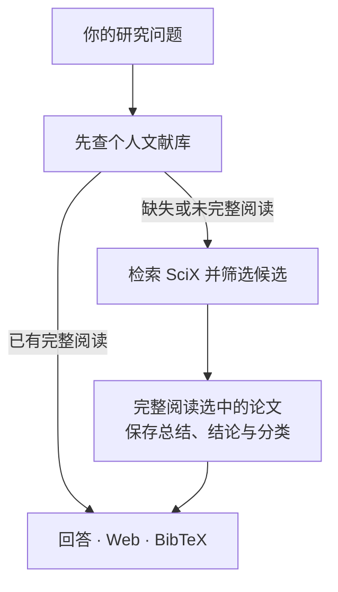
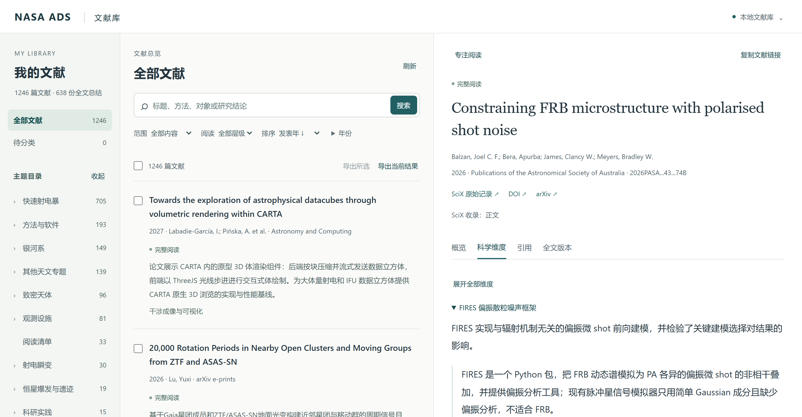

<h1 align="center">NASA ADS Skill</h1>

<div align="center">

**用于天文文献调研、论文写作与个人知识积累**

文献综述 · 写作证据 · 本地 Web · BibTeX

[](https://scixplorer.org/)
[](plugins/nasa-ads/.codex-plugin/plugin.json)
[](https://www.python.org/)
[](#打开-web-文献库)
[](LICENSE)
[](https://github.com/SukiYume/nasa-ads-skill)

[项目概览](#项目概览) ·
[安装](#一句话交给-agent-安装) ·
[开始使用](#开始使用) ·
[个人文献库](#文献库保存什么) ·
[Web](#打开-web-文献库) ·
[排错](#排错) ·
[English](README.md)

</div>

---

## 项目概览

**NASA ADS Skill** 将接替 NASA ADS 的 NASA Science Explorer [SciX](https://scixplorer.org/) 接入 Claude Code、Codex、Gemini CLI 及其他 Markdown skill 宿主。你用自然语言提出天文问题，Agent 检索 SciX、阅读论文，并为**综述以及论文的引言、方法和讨论**给出可追溯的证据。

每次任务还会为你积累一个个人文献库：

- **读全文，而不只看摘要。** Agent 打开过正文的每篇论文都会完整读一遍，并且无论当时问的是什么，都把整篇文章总结入库：一句话总结、一段式总结、每个章节的摘要，以及每条可引用结果的关键数值、所在章节、表格、图或公式，和一小段原文摘句。下次再用到这篇论文时，直接从已存的总结开始。
- **精确引用具体结果。** 写论文时常常只引用一篇文章中的某个数值或某条推论。之后可以直接取出这条结果，附原文位置、引用键和原始出处，并且只重新打开已存原文中陈述它的那一段。
- **浏览与导出。** 本地 Web 页面可以按主题和写作用途浏览文献库，并导出 BibTeX。

### 工作方式



入库是任务的一部分，静默完成：你拿到的是科学答案，文献库在后台不断积累。

## 一句话交给 Agent 安装

将下面的提示词粘贴给可以使用终端和网络的 Agent。它会按你的宿主选择安装步骤，并检查安装结果。

<details>
<summary><strong>展开并复制安装提示词</strong> · 由 Agent 完成安装与验证</summary>

```text
请在这台电脑上从 https://github.com/SukiYume/nasa-ads-skill 安装当前 NASA ADS Skill：阅读 README，按其中“安装”部分里当前 Agent 宿主对应的步骤安装缺少的前置条件和完整 skill，需要替换时仅更新已有的 nasa-ads；检查 ADS_API_TOKEN 且不显示其值，不存在时引导我配置在线 SciX 请求所需的 token；确认 SKILL.md、agents/openai.yaml、scripts/ads_api.py、scripts/fulltext.py、scripts/literature_db.py、scripts/library_catalog.py、scripts/library_migrate.py、scripts/library_web.py、scripts/adslib.py、assets/index.html、assets/style.css、assets/app.js、references/research-writing.md、references/ads-cli.md、references/fulltext.md、references/literature-memory.md、references/library-maintenance.md、references/digest-schema.md、references/libraries.md 和 references/http-fallback.md 均已安装，阅读已安装的 SKILL.md，分别检查四个 CLI 的版本，从已安装的 scripts/adslib.py 执行 install 注册 adslib 命令并在新终端验证 adslib --version，凭据可用时完成 README“验证安装”部分的 API、全文与文献库检查，确认 Web 页面能打开，并报告安装路径、版本与验证结果。
```

</details>

## 安装

### 前置条件

- **Agent 宿主**：[Claude Code](https://code.claude.com/docs/en/setup)、[Codex](https://developers.openai.com/codex/cli/)、[Gemini CLI](https://geminicli.com/docs/get-started/installation/)，或其他能加载 Markdown skill 的助手。
- **[Python 3.10 或更新版本](https://www.python.org/downloads/)**：全文阅读、个人文献库和 Web 都需要。自带脚本只使用标准库。没有 Python 时，Agent 仍可通过 `curl` 或 PowerShell 完成基础 SciX 请求，但无法阅读全文或保存文献库。
- **[Git](https://git-scm.com/downloads/)**：独立 skill 和 Gemini 安装需要。
- **SciX token**：用于在线检索，见[配置 SciX Token](#配置-scix-token)。浏览文献库和导出已缓存的引用可以离线进行。
- **可选 PDF 工具**：`pdftotext` 和 `pdfinfo` 改善 PDF 文本抽取，`pdftoppm` 渲染扫描页面。没有这些工具时，能力足够的宿主会直接以视觉方式阅读 PDF 或页面图像。
- **HTTPS 访问**：需要访问 `api.scixplorer.org`、`arxiv.org` 以及出版社或仓储网站。

按你的宿主选择安装方式：

| 当前宿主 | 安装方式 | 如何调用 |
| --- | --- | --- |
| **Claude Code** | [插件](#claude-code-插件)或[独立 skill](#独立-skill) | 自然语言或 `/nasa-ads:ads-search` |
| **Codex CLI / 桌面应用** | [插件](#codex-插件)或[独立 skill](#独立-skill) | 自然语言或 `$nasa-ads` |
| **Codex IDE 扩展** | [独立 skill](#独立-skill) | 自然语言或 `$nasa-ads` |
| **Gemini CLI** | [`GEMINI.md` 导入](#gemini-cli) | 自然语言 |
| **其他助手** | [Markdown skill 目录](#其他宿主) | 宿主自身的 skill 加载方式 |

任何一种方式安装后，都需要[注册一次 adslib 命令](#注册-adslib-命令)并[配置 SciX token](#配置-scix-token)。

### Claude Code 插件

Claude Code 2.1.275 或更新版本可以在会话中执行：

```text
/plugin install nasa-ads --marketplace SukiYume/nasa-ads-skill
```

任何版本都可以在终端中执行：

```bash
claude plugin marketplace add SukiYume/nasa-ads-skill
claude plugin install nasa-ads@nasa-ads-community
claude plugin list
```

列表中应出现 `nasa-ads@nasa-ads-community`。然后启动 `claude`，或在已打开的会话中执行 `/reload-plugins`。

### Codex 插件

Codex 插件适用于 Codex CLI 和桌面应用：

```bash
codex plugin marketplace add SukiYume/nasa-ads-skill
codex plugin add nasa-ads@nasa-ads-community
codex plugin list
```

新建一个 Codex 会话后，`/skills` 中就会出现该 skill。

### 独立 skill

独立 skill 是把 skill 目录复制到宿主的 skill 目录中：Codex CLI 和 IDE 扩展使用 `~/.agents/skills/nasa-ads`，Claude Code 使用 `~/.claude/skills/nasa-ads`。保留一份源码克隆，便于以后更新。

macOS、Linux 或 WSL：

```bash
git clone --depth 1 https://github.com/SukiYume/nasa-ads-skill.git "$HOME/.local/share/nasa-ads-skill"
skill_dir="$HOME/.agents/skills/nasa-ads"    # Claude Code: "$HOME/.claude/skills/nasa-ads"
mkdir -p "$skill_dir"
cp -R "$HOME/.local/share/nasa-ads-skill/plugins/nasa-ads/skills/nasa-ads/." "$skill_dir/"
```

Windows PowerShell：

```powershell
$nasaAdsSource = Join-Path $HOME 'nasa-ads-skill-source'
$skillDir = Join-Path $HOME '.agents\skills\nasa-ads'    # Claude Code: '.claude\skills\nasa-ads'
git clone --depth 1 https://github.com/SukiYume/nasa-ads-skill.git $nasaAdsSource
New-Item -ItemType Directory -Force $skillDir | Out-Null
Copy-Item -Recurse -Force (Join-Path $nasaAdsSource 'plugins\nasa-ads\skills\nasa-ads\*') $skillDir
```

完成后新建会话。在 Codex 中，`/skills` 会列出它，`$nasa-ads` 可直接调用。只在某个仓库中使用时，把同一目录复制到 `<仓库>/.agents/skills/nasa-ads`。

### Gemini CLI

Gemini CLI 通过 `~/.gemini/GEMINI.md` 加载 skill。

macOS、Linux 或 WSL：

```bash
git clone --depth 1 https://github.com/SukiYume/nasa-ads-skill.git "$HOME/.gemini/nasa-ads-skill"
printf '\n@./nasa-ads-skill/plugins/nasa-ads/skills/nasa-ads/SKILL.md\n' >> "$HOME/.gemini/GEMINI.md"
```

Windows PowerShell：

```powershell
git clone --depth 1 https://github.com/SukiYume/nasa-ads-skill.git "$HOME\.gemini\nasa-ads-skill"
Add-Content -Path "$HOME\.gemini\GEMINI.md" -Value "`n@./nasa-ads-skill/plugins/nasa-ads/skills/nasa-ads/SKILL.md"
```

启动 `gemini` 后执行 `/memory reload` 和 `/memory show`，加载的内容中应包含 `SciX Literature Workflow` 标题。仓库自带的 [`GEMINI.md`](GEMINI.md) 演示了项目级配置的同一种导入写法。

### 其他宿主

克隆仓库，把完整的 `plugins/nasa-ads/skills/nasa-ads/` 目录复制到宿主的 skill 或提示词目录，并让宿主加载 `SKILL.md`。宿主需要能用 Python 3 运行自带脚本。发现目录和调用方式以宿主自身的文档为准。

### 注册 adslib 命令

`adslib` 可以在任意终端打开 Web 文献库。每台电脑只需注册一次：在已安装的 skill 目录中执行 `install`，或者直接告诉 Agent：

> 找到已安装 nasa-ads skill 中的 scripts/adslib.py，执行 install 注册 adslib，保留我现有的 PATH 设置，并在新终端中验证 adslib --version。

Codex 独立 skill 的命令：

```bash
python3 "$HOME/.agents/skills/nasa-ads/scripts/adslib.py" install     # macOS, Linux, or WSL
```

```powershell
python "$HOME\.agents\skills\nasa-ads\scripts\adslib.py" install       # Windows PowerShell
```

Claude Code 独立 skill 使用 `~/.claude/skills/nasa-ads/scripts/adslib.py`，Gemini 使用 `~/.gemini/nasa-ads-skill` 中的脚本，插件使用其已加载 `SKILL.md` 所在的目录，Agent 可以告诉你具体位置。

安装程序会创建 `~/.local/bin/adslib`（Windows 上另有 `adslib.cmd`），并在需要时把该目录加入 PATH，同时保留你现有的设置和其他同名命令。如果想自行管理 PATH，可以用 `install --bin-dir <目录> --no-path` 指定目录。打开新终端检查 `adslib --version`。移动 skill、更换 Python 或更新插件后需要重新执行 `install`，因为插件更新后会使用新的目录。

## 配置 SciX Token

在线 SciX 请求需要保存在 `ADS_API_TOKEN` 中的个人 token。NASA ADS 的账号和 token 可以直接在 SciX 使用。

1. 打开 [SciX token 设置](https://scixplorer.org/user/settings/token)并登录。
2. 在 **API Token** 中生成 token 并复制。
3. 把它保存为环境变量，然后打开新终端并重启 Agent。

macOS、Linux 或 WSL：把下面这行加入 shell 启动文件，例如 `~/.zshrc` 或 `~/.bashrc`：

```bash
export ADS_API_TOKEN='paste-your-token-here'
```

Windows PowerShell：

```powershell
[Environment]::SetEnvironmentVariable('ADS_API_TOKEN', 'paste-your-token-here', 'User')
```

检查 token 是否已设置，不显示其值：

```bash
if [ -n "${ADS_API_TOKEN:-}" ]; then echo "SciX token is set"; else echo "SciX token is missing"; fi
```

```powershell
if ($env:ADS_API_TOKEN) { 'SciX token is set' } else { 'SciX token is missing' }
```

不要把 token 放进代码仓库、截图、日志或求助信息；一旦泄露，请在 SciX 设置中重新生成。

## 验证安装

向 Agent 发出：

> 使用 nasa-ads 检索 bibcode 2016PhRvL.116f1102A，返回标题、年份和 SciX 链接。

在 Claude Code 中也可以执行 `/nasa-ads:ads-search bibcode:2016PhRvL.116f1102A`。结果应为 *Observation of Gravitational Waves from a Binary Black Hole Merger*（2016）。如果提示缺少 token，说明 Agent 没有继承 `ADS_API_TOKEN`，请在已设置 token 的终端中重新启动它。

如果想自己检查脚本，先用一个变量指向已安装的 skill 目录，本文后面的命令都会沿用它。示例使用 Codex 独立 skill 的位置；其他安装请替换为 `~/.claude/skills/nasa-ads`、`~/.gemini/nasa-ads-skill/plugins/nasa-ads/skills/nasa-ads`，或 Agent 报告的插件目录。

macOS、Linux 或 WSL：

```bash
nasa_ads_skill="$HOME/.agents/skills/nasa-ads"
python3 "$nasa_ads_skill/scripts/ads_api.py" --version
python3 "$nasa_ads_skill/scripts/fulltext.py" --version
python3 "$nasa_ads_skill/scripts/literature_db.py" --version
python3 "$nasa_ads_skill/scripts/adslib.py" --version
python3 "$nasa_ads_skill/scripts/ads_api.py" --no-store search --query 'bibcode:2016PhRvL.116f1102A' --fields bibcode,title,year --rows 1
```

Windows PowerShell：

```powershell
$nasaAdsSkill = Join-Path $HOME '.agents\skills\nasa-ads'
python "$nasaAdsSkill/scripts/ads_api.py" --version
python "$nasaAdsSkill/scripts/fulltext.py" --version
python "$nasaAdsSkill/scripts/literature_db.py" --version
python "$nasaAdsSkill/scripts/adslib.py" --version
python "$nasaAdsSkill/scripts/ads_api.py" --no-store search --query 'bibcode:2016PhRvL.116f1102A' --fields 'bibcode,title,year' --rows 1
```

四个版本号都应为 `3.2.0`，检索结果应包含 `2016PhRvL.116f1102A`。如果 Windows 上以 `py -3` 注册 Python，请改用 `py -3`。`--no-store` 让测试结果不进入你的文献库。

<details>
<summary><strong>全文与文献库检查</strong></summary>

这些检查不需要 SciX token，也不会改动你的文献库：

```bash
python3 "$nasa_ads_skill/scripts/fulltext.py" fetch arXiv:1901.04502 --source arxiv --no-store
python3 "$nasa_ads_skill/scripts/literature_db.py" template
```

```powershell
python "$nasaAdsSkill/scripts/fulltext.py" fetch 'arXiv:1901.04502' --source arxiv --no-store
python "$nasaAdsSkill/scripts/literature_db.py" template
```

抓取结果应报告来自 `https://arxiv.org/html/1901.04502` 的 `status: fulltext`，并在下载缓存中列出 `artifact_path`、`text_path` 和 `manifest_path`；`fulltext.py outline <text_path>` 可以查看推断出的章节及其起始行号。需要公式、图表或页面版式时，`--format pdf` 会获取 PDF。模板会输出 schema 4 阅读记录，包含 `overview`、`facets`、`findings` 和 `reading.sections`。

</details>

## 开始使用

说明科学问题和所需证据即可：

| 你要完成的事情 | 请求示例 |
| --- | --- |
| **文献综述** | “综述 2022 年以来的重复 FRB 研究，按科学问题组织，说明分歧与研究空白。” |
| **引言证据** | “为这段引言寻找奠基性和近期原始论文，逐条对应计划写出的论断。” |
| **方法依据** | “查找这个周期检验的原始方法和验证研究，比较假设、试验因子及适用限制。” |
| **讨论证据** | “查找支持或挑战这个解释的研究，比较样本选择与不确定性。” |
| **阅读指定文章** | “阅读 arXiv:1901.04502，总结方法、发现与局限。” |
| **阅读你下载的 PDF** | “我通过学校下载了 2021Natur.598..267L，放在 `~/Downloads/li2021.pdf`，请阅读并保存阅读记录。” |
| **核查文章细节** | “解释这篇论文图 3 的结果，并核对作者的结论。” |
| **按主题词检索** | “查找 2024 年以来 UAT 主题为 fast radio bursts、且 SciX 收录全文的论文。” |
| **发表趋势** | “2015 年以来每年有多少篇关于快速射电暴的审稿论文，分别发表在哪些期刊？” |
| **复用已有阅读** | “在本地文献库中查找圆偏振符号反转，给出相关结论和证据位置。” |
| **复用已存数值** | “整理文献库中已存的拟合谱指数，附不确定度、模型和表格位置，生成带引用键的对比表。” |
| **引用具体结果** | “在文献库中找出由爆发偏振推断磁层起源的那条推论，给出章节和引用键，并核对它是否转述自更早的工作。” |
| **导出引用** | “给我这三个 bibcode 的 AASTeX 格式参考文献”，或“把它们排成 MNRAS 格式的参考文献列表。” |
| **匹配参考文献列表** | “把我草稿里的参考文献列表匹配到 SciX 记录，并导出为 BibTeX。” |
| **SciX 账号工具** | “列出我的 SciX libraries”，或“查看这些 bibcode 的引用指标。” |

你可以预期：

- Agent 先查你的文献库并复用已有的完整阅读，再到 SciX 检索缺失或更新的工作。
- 宽泛检索的候选会先按标题和摘要筛选，保留下来的连同简短总结一起入库。
- Agent 评估过内容的每篇论文都会完整阅读并入库，包括最终没有写进回答的论文。只问一张图或一个数值时，第一次也会完成整篇阅读。
- 写论文时，每个论断都引用它所依据的具体结论或数值及其原文位置；文章借用的结果会追溯到原始出处。只有摘要支撑的论断会明确标注。
- 全文无法获取或保存失败时，会随回答一起说明。只能拿到摘要时，你可以通过自己的访问权限下载文章，把文件路径交给 Agent。

Claude Code 还提供斜杠命令：

```text
/nasa-ads:ads-search <research question or SciX query>
/nasa-ads:ads-fulltext <bibcodes, DOIs, or arXiv IDs> [local PDF] [question]
/nasa-ads:ads-memory <lookup, search, findings, parameters, passage, collections, citations, adslib, or maintenance>
/nasa-ads:ads-bibtex <identifiers> [--format]
/nasa-ads:ads-cite [suggest | similar | links | refs] <bibcodes or reference strings>
/nasa-ads:ads-metrics <bibcodes>
/nasa-ads:ads-library [subcommand]
```

## 文献库保存什么

文献库保存在当前电脑上，与安装的 skill 相互独立；新电脑上的文献库一开始是空的，可以把原来的[迁移过去](#迁移到新电脑)。文献库保存每篇论文的书目记录、SciX 主题词、来源摘要、已存文章文件、Agent 的阅读记录、你的主题和笔记，以及缓存的引用。

### 阅读层级

| 阅读层级 | 能够支持的内容 |
| --- | --- |
| **题录** | 识别论文、判断相关性 |
| **摘要** | 关于摘要所报告内容的陈述 |
| **完整阅读或视觉阅读** | 关于某个精确文章版本的数据、方法、数值、图表和结论的论断 |

宽泛检索找到的论文通常停留在题录或摘要层级。Agent 深入调研的论文会得到完整阅读；扫描版 PDF 会逐页做视觉阅读。一篇论文可以保存多个版本，例如预印本和期刊版，因此论文数和阅读数可能不同。读过预印本之后再获取的期刊版，会另做一次完整阅读。

### 完整阅读记录的内容

完整阅读记录是分层的，之后的问题只需读到所需的深度：

- **一句话总结与一段式总结**：论文做了什么、发现了什么，附关键数值、研究问题和研究类型。
- **章节摘要**：文章的每个章节都有一段摘要，说明它的论点、数据、方法、结果和注意事项。合起来就是整篇文章的总结。
- **结论**：论文中值得写进文章引用的结果，按科学主题分组：测量、约束、未探测、作者推论、模型预测、与其他工作的比较以及作者说明的局限。每条都带章节、图、表或公式位置、作者对它的确定程度、形如 `polarization.2` 的编号，以及一小段原文摘句，用来定位已存原文中的对应段落。
- **数值**：关键数值及其符号、单位、不确定度或区间，是测量、拟合、推导、假设、预测还是上下限，以及适用的模型和条件。
- **研究对象、数据与方法**：涉及的天体和设施及其其他名称，每组观测或样本，每种分析方法及其假设。
- **出处**：文章从其他工作借用的结果、数值、数据或方法指向原始文献，比较类结论注明比较对象。
- **阅读评估**：读者对结论稳健性和注意事项的评价，与文章本身的陈述分开存放。
- **数据产品**：公开的数据、代码和表格。

阅读记录统一用中文书写，整个文献库只用一种语言；原文摘句、天体名称、符号和单位保持文章中的写法，英文检索词照样能匹配。一篇典型的研究论文会记录 10 到 25 条结论。观测日志、长表格和完整的原文表述保留在已存原文中，问题需要时，Agent 会直接打开对应的段落或章节。

### 主题、用途与笔记

主题采用层级结构，例如 `快速射电暴/传播效应/散射`，一篇论文可以属于多个主题。写作用途（综述、引言、方法、讨论、结果比较）标记论文在你稿件中的作用。标签和个人笔记便于以后查找，主题还可以附一段简短综述。主题、用途和笔记的新建或修改都交给 Agent 完成。

## 复用结论、数值与引用

### 查询已存结论与数值

可以直接用自然语言提问：

> 列出文献库中已存的持续射电源光度上限，附置信水平、适用条件和引用键。

> 文献库里哪些数值是文章引用前人工作而非自己分析得到的？逐一追溯到原始出处。

也可以直接查询：`findings` 列出可引用的结论，`parameters` 列出数值，加上 `--format csv --output <文件>` 可写出能用表格软件打开的文件。

```bash
python3 "$nasa_ads_skill/scripts/literature_db.py" findings "magnetospheric origin" --kind interpretation
python3 "$nasa_ads_skill/scripts/literature_db.py" parameters "rotation measure" --entity "FRB 20121102A"
python3 "$nasa_ads_skill/scripts/literature_db.py" parameters --paper "2016PhRvL.116f1102A" --format csv --output parameters.csv
```

```powershell
python "$nasaAdsSkill/scripts/literature_db.py" findings "magnetospheric origin" --kind interpretation
python "$nasaAdsSkill/scripts/literature_db.py" parameters "rotation measure" --entity "FRB 20121102A"
python "$nasaAdsSkill/scripts/literature_db.py" parameters --paper "2016PhRvL.116f1102A" --format csv --output parameters.csv
```

每一行显示引用键、文章版本、阅读层级、对应结论及其 `finding_id`、原文位置；文章转述前人结果时，`cited_from` 给出原始出处。`--kind prediction` 筛选模型预测，`--status fitted` 或 `--status upper-limit` 限定数值类型。结果只来自完整阅读；出现在 `without_complete_digest` 中的论文仍需阅读。

`passage` 只输出已存原文的一小部分：某条结论所在的段落、一个章节，或提到某个词的段落。用它核对引用的数值，只需读一段而不是整篇论文。

```bash
python3 "$nasa_ads_skill/scripts/literature_db.py" passage "2016PhRvL.116f1102A" --finding "<finding_id>"
python3 "$nasa_ads_skill/scripts/literature_db.py" passage "2016PhRvL.116f1102A" --section "Discussion"
python3 "$nasa_ads_skill/scripts/literature_db.py" passage "2016PhRvL.116f1102A" --grep "false alarm"
```

```powershell
python "$nasaAdsSkill/scripts/literature_db.py" passage "2016PhRvL.116f1102A" --finding "<finding_id>"
python "$nasaAdsSkill/scripts/literature_db.py" passage "2016PhRvL.116f1102A" --section "Discussion"
python "$nasaAdsSkill/scripts/literature_db.py" passage "2016PhRvL.116f1102A" --grep "false alarm"
```

`passage <paper> --outline` 列出已存章节及其摘要，是回顾一篇论文内容最快的方式。

### 导出引用

> 导出我所选主题下论文的 BibTeX，优先使用缓存的 SciX 官方条目，并保存为 references.bib。

```bash
python3 "$nasa_ads_skill/scripts/literature_db.py" citations --collection "FRB/Propagation" --output references.bib
python3 "$nasa_ads_skill/scripts/literature_db.py" citations --all --output personal-library.bib
python3 "$nasa_ads_skill/scripts/literature_db.py" citations "2016PhRvL.116f1102A" --fetch
```

```powershell
python "$nasaAdsSkill/scripts/literature_db.py" citations --collection "FRB/Propagation" --output references.bib
python "$nasaAdsSkill/scripts/literature_db.py" citations --all --output personal-library.bib
python "$nasaAdsSkill/scripts/literature_db.py" citations "2016PhRvL.116f1102A" --fetch
```

SciX 官方条目保留原有引用键。没有缓存官方条目的论文，会根据本地书目信息生成条目并加以标注，与 SciX 导出一致，只列前十位作者再加 et al.；`--fetch` 下载并缓存官方条目，需要 token。需要 RIS、AASTeX、MNRAS 等格式时，告诉 Agent 即可，它会使用 SciX 的引用导出。草稿里的参考文献列表也可以这样匹配到 SciX 记录；Agent 会逐条解析参考文献，并给出每条匹配的可信度。

## 打开 Web 文献库

[注册 adslib](#注册-adslib-命令) 后，在任意目录执行：

```bash
adslib
```

它会启动后台服务并打开浏览器，之后可以关闭终端。重启电脑后再次执行即可。页面无需 SciX token，可以离线使用。



| 命令 | 功能 |
| --- | --- |
| `adslib` / `adslib open` | 打开文献库，需要时启动服务 |
| `adslib start` | 后台启动，不打开浏览器 |
| `adslib status` | 查看地址、文献库目录、版本和进程号 |
| `adslib stop` / `adslib restart` | 停止或重启服务 |
| `adslib serve` | 前台运行，按 `Ctrl+C` 停止 |

`--library-dir "<目录>"` 打开另一个文献库，`--port 8766` 指定端口，例如 `adslib --library-dir "$HOME/other-library" --port 8766`。`status`、`stop` 和 `restart` 会找到所选文献库的服务，无论它用的是哪个端口；操作其他文献库时传 `--library-dir`，只有同一文献库运行了多个服务时才需要用 `--port` 指定。`--no-open` 不打开浏览器。默认地址是 `http://127.0.0.1:8765`；端口被占用时会改用空闲端口，请以输出的地址为准。启动时会打印日志路径；日志和服务记录在 Windows 上位于 `%LOCALAPPDATA%\nasa-ads\runtime`，其他系统位于 `${XDG_STATE_HOME:-~/.local/state}/nasa-ads/runtime`，也可以用 `NASA_ADS_RUNTIME_DIR` 指定。注册命令之前，可以直接运行已安装 skill 目录中的 `scripts/adslib.py`。

| 你想做的事 | 操作 |
| --- | --- |
| 查找主题 | 展开主题目录；上级主题包含其下所有子主题 |
| 查找某个稿件章节要用的论文 | 把主题与写作用途组合，例如方法或讨论 |
| 检索特定层级 | 选择题录、总结或已存全文 |
| 限定年份 | 打开年份控件，输入范围后应用 |
| 按 SciX 主题词浏览 | 点击论文概览中的主题词 |
| 阅读论文结论 | 在概览、科学维度、引用和全文版本之间切换 |
| 查看数据、方法与数值 | 概览以一句话总结开头，列出研究类型、研究对象、观测、方法、局限和阅读评估；科学维度显示每条结论的编号、位置、原文摘句和出处，以及每个数值的不确定度、类型和模型 |
| 回到同一视图 | 复制页面链接，它会保留筛选、页码、论文和标签页 |
| 使用键盘 | `/` 聚焦搜索框；Escape 关闭年份控件或阅读面板；方向键切换标签页 |
| 查看新入库的论文 | Agent 更新文献库后点击刷新 |
| 导出引用 | 下载勾选的论文或整组筛选结果，最多 2000 篇 |

页面只读；修改总结、主题、用途或笔记请交给 Agent。文献库信息按钮会显示页面正在读取的目录。

## 管理文献库

本节的所有操作都可以交给 Agent 完成。手动命令使用[验证安装](#验证安装)中设置的 skill 目录变量。

### 数据位置

| 设置 | 位置或作用 |
| --- | --- |
| Windows 默认 | `%LOCALAPPDATA%\nasa-ads\literature` |
| macOS / Linux / WSL 默认 | `${XDG_DATA_HOME:-~/.local/share}/nasa-ads/literature` |
| `NASA_ADS_LITERATURE_DIR` | 让调研、入库和 Web 使用另一个文献库目录 |
| `NASA_ADS_CACHE_DIR` | 更改临时下载缓存的位置 |

文献库目录包含 `literature.sqlite3` 和保存文章的 `objects/` 目录。清空下载缓存后，已存的阅读仍然可用。Agent 和 Web 必须使用同一目录；更改目录后请重启 Web 服务。迁移文献库请使用备份与恢复，保证其中记录的路径仍然有效。

### 迁移到新电脑

> 备份我的个人文献库，并告诉我需要转移的备份目录；在新电脑上把它恢复到一个新目录，并让 Agent 和 Web 使用这个目录。

1. 在原电脑上执行 `backup`。它会报告一个新目录，其中包含数据库快照、已存文章和 `backup.json`。

   ```bash
   python3 "$nasa_ads_skill/scripts/literature_db.py" backup
   ```

   ```powershell
   python "$nasaAdsSkill/scripts/literature_db.py" backup
   ```

2. 把整个目录复制到新电脑，并在新电脑上安装 skill 和 Python。示例假设它位于 `~/nasa-ads-library-backup`，恢复到新目录 `~/nasa-ads-literature`。

3. 恢复并选用该文献库：

   ```bash
   python3 "$nasa_ads_skill/scripts/literature_db.py" restore "$HOME/nasa-ads-library-backup" --destination "$HOME/nasa-ads-literature"
   export NASA_ADS_LITERATURE_DIR="$HOME/nasa-ads-literature"    # also add to ~/.zshrc or ~/.bashrc
   ```

   ```powershell
   python "$nasaAdsSkill/scripts/literature_db.py" restore "$HOME/nasa-ads-library-backup" --destination "$HOME/nasa-ads-literature"
   [Environment]::SetEnvironmentVariable('NASA_ADS_LITERATURE_DIR', "$HOME/nasa-ads-literature", 'User')
   ```

4. 打开新终端，新建 Agent 会话，执行[状态检查](#检查文献库状态)，再运行 `adslib`。各项数量应与原文献库一致。

### 检查文献库状态

```bash
python3 "$nasa_ads_skill/scripts/literature_db.py" stats
python3 "$nasa_ads_skill/scripts/literature_db.py" check
python3 "$nasa_ads_skill/scripts/literature_db.py" audit
```

```powershell
python "$nasaAdsSkill/scripts/literature_db.py" stats
python "$nasaAdsSkill/scripts/literature_db.py" check
python "$nasaAdsSkill/scripts/literature_db.py" audit
```

`stats` 显示各项数量和文献库目录。`check` 列出仍待总结或待分类的论文，以及已下载但尚未读入文献库的文章版本（例如读过预印本之后才获取的期刊版），只要还有待办，退出码就是 1；`check --recent 12` 只检查最近 12 小时的工作。`audit` 检查数据库、已存文件、元数据和引用缓存；有些出版物本来就缺少摘要等字段，报告会把这类情况与真正的错误区分开。大规模清理之后，`compact` 可以把数据库文件压缩回实际大小。

如果 Agent 提示同一篇文章有两份不同的阅读记录，说明预印本和期刊版曾分别入库并各自完整阅读。数据不会丢失；请 Agent 统一两份阅读，之后两条记录会合并为一条。

如果检索找不到预期的内容，请选择对应的范围：题录对应标题和摘要，总结对应 Agent 的阅读记录，全文对应已存文章。中文词语按子串匹配。

### 刷新 SciX 元数据

> 备份我的个人文献库，从 SciX 刷新所有已存论文的元数据，补齐缺少的来源总结，并为缺少官方 BibTeX 的论文缓存官方条目。

刷新会纠正书目字段，补充 SciX 主题词和新出现的摘要，把预印本和临时 bibcode 更新为期刊记录，并合并身份核实后的重复记录，保留它们的阅读、主题、标签和笔记。引用信息变化后，旧的缓存引用会被替换。文献库中的论文陆续正式发表后执行。刷新需要 SciX token。

## 更新 skill

用安装时的同一种方式更新，然后新建 Agent 会话。共用同一个文献库的所有安装应保持相同版本。

插件：

```bash
claude plugin marketplace update nasa-ads-community
claude plugin update nasa-ads@nasa-ads-community
codex plugin marketplace upgrade nasa-ads-community
codex plugin add nasa-ads@nasa-ads-community
```

独立 skill：整体替换已安装的文件夹，避免更新时删除的旧文件残留。该文件夹只包含打包的 skill，文献库保存在自己的[数据位置](#数据位置)。如果安装时选了其他目录，请替换为你的目录：

```bash
git -C "$HOME/.local/share/nasa-ads-skill" pull --ff-only
rm -rf "$HOME/.agents/skills/nasa-ads"
cp -R "$HOME/.local/share/nasa-ads-skill/plugins/nasa-ads/skills/nasa-ads" "$HOME/.agents/skills/nasa-ads"
```

```powershell
git -C (Join-Path $HOME 'nasa-ads-skill-source') pull --ff-only
$skillDir = Join-Path $HOME '.agents\skills\nasa-ads'
Remove-Item -Recurse -Force $skillDir
Copy-Item -Recurse (Join-Path $HOME 'nasa-ads-skill-source\plugins\nasa-ads\skills\nasa-ads') $skillDir
```

Gemini CLI：在任一 shell 中执行 `git -C "$HOME/.gemini/nasa-ads-skill" pull --ff-only`，再执行 `/memory reload`。

插件更新后，请在新的插件目录中执行 `adslib.py install`，然后检查 `adslib --version` 并重新[验证安装](#验证安装)。

## 排错

| 现象 | 下一步 |
| --- | --- |
| 宿主找不到 skill | 按你的宿主重新执行[安装](#安装)，再新建会话 |
| Python 无法启动 | 安装 Python 3.10 或更新版本，尝试 `python3`、`python` 或 Windows 的 `py -3` |
| SciX 返回 `401` 或提示缺少 token | 检查 [token](#配置-scix-token)，并从已设置 token 的终端重启 Agent |
| SciX 返回 `403` 或 `429` | `403`：检查账号或 library 权限；`429`：等待返回的限流恢复时间 |
| 找不到 `adslib` 命令 | [注册命令](#注册-adslib-命令)后打开新终端；旧终端或 IDE 可重启后再试 |
| Web 页面连接失败 | 运行 `adslib`，保持服务运行，并打开它输出的准确地址 |
| Web 数量不符合预期或显示空库 | 核对页面显示的文献库目录、当前筛选和[数据位置](#数据位置) |
| 论文显示待总结或待分类 | 让 Agent 完成相关总结和主题分类 |
| Agent 提示同一篇文章有两份不同的阅读 | 请它统一两份阅读（[详情](#检查文献库状态)） |
| 全文无法获取 | 回答会使用现有题录或摘要，并说明缺口；你可以通过自己的访问权限下载文章，把文件路径交给 Agent 完整阅读 |
| 本地检索找不到原句 | 改为搜索已存全文（[检索范围](#检查文献库状态)） |
| Agent 提示文献库来自较早版本 | 让 Agent 迁移文献库；`literature_db.py migrate` 会先备份，并给出备份位置 |

## 隐私与延伸阅读

SciX token 只用于 SciX 请求。文章来自合法可访问的出版社、仓储、arXiv 或 SciX 来源，或你提供的文件。论文、阅读记录和引用缓存保存在本地文献库；Agent 宿主会按自身的数据政策处理任务中读取的内容。

- [给 Agent 的 skill 说明](plugins/nasa-ads/skills/nasa-ads/SKILL.md)，包括[阅读记录格式](plugins/nasa-ads/skills/nasa-ads/references/digest-schema.md)和[文献库命令](plugins/nasa-ads/skills/nasa-ads/references/literature-memory.md)
- [SciX CLI 参考](plugins/nasa-ads/skills/nasa-ads/references/ads-cli.md)、[SciX Libraries](plugins/nasa-ads/skills/nasa-ads/references/libraries.md) 和[直接 HTTP 回退](plugins/nasa-ads/skills/nasa-ads/references/http-fallback.md)
- [SciX API 文档](https://scixplorer.org/scixhelp/api/)

## License

[MIT](LICENSE)

---

<p align="center">
  <sub>NASA ADS Skill · 每一次检索，都成为可复用的文献积累。</sub>
</p>
